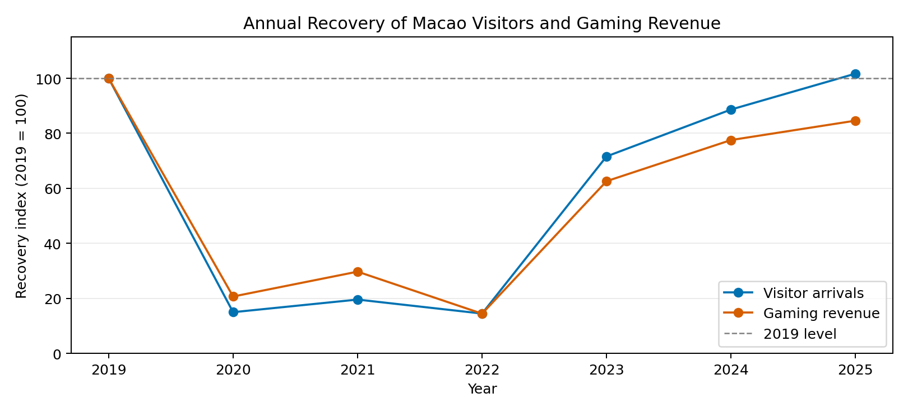
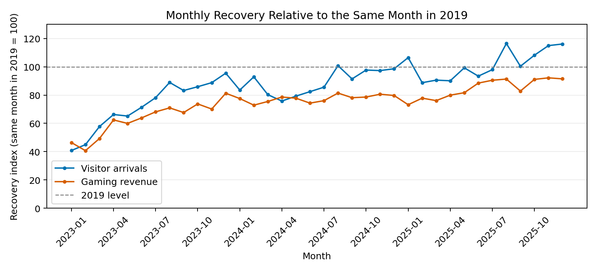
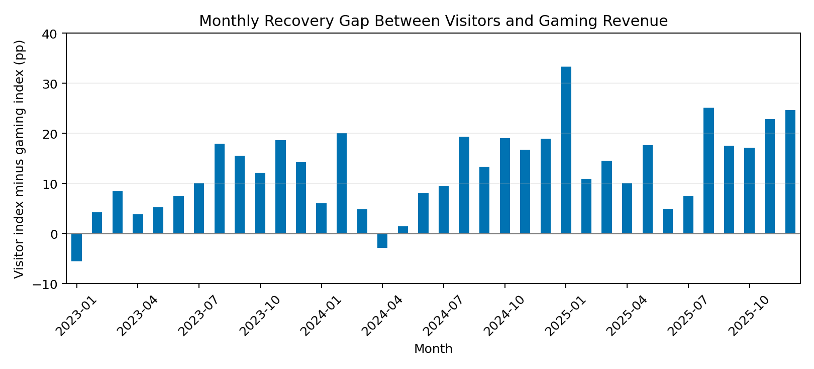
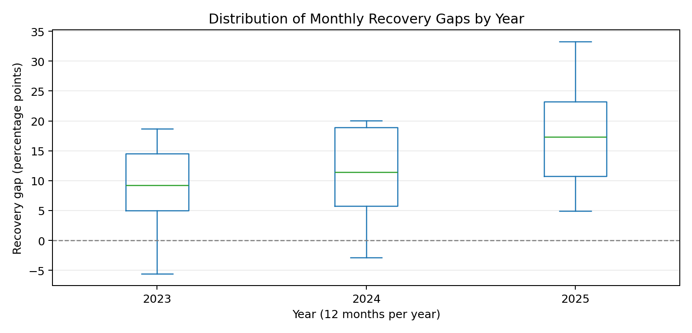

# Macao Tourism and Gaming Recovery

**Research question:** Did Macao visitor arrivals and gross gaming revenue recover at the same pace after the pandemic, relative to 2019?

A CISC7204 Assignment 2 Pair 01 project, presented in the personal portfolio of **Jiawei Sun (Bewick)**. **Status: ongoing**; the current descriptive analysis is complete and interpretation can be developed further.

## Data and permissions

Monthly visitor arrivals from MGTO (source: DSEC) and monthly gross revenue from games of fortune from DICJ. Monthly inputs contain 48 observations each: 2019 and 2023–2025. Annual background data cover 2019–2025. Arrivals count visits, not unique people; gaming revenue is nominal, in MOP million.

See [SOURCES.md](SOURCES.md) for official links, extraction rules and usage permissions. These are attributed public aggregate statistics. DSEC allows reproduction with attribution in its publications; no explicit open-data licence was verified for DICJ. No blanket licence is asserted over the source data, and source website archives are excluded. There are no personal records, credentials or restricted datasets in this project.

## Methods and tools

Python, pandas and Matplotlib. Merge on Year/Month, check missing and duplicate keys, match each study month to the same month in 2019, then calculate `value / 2019 same-month value * 100`. The gap is visitor index minus gaming index in percentage points. Annual indices use annual totals, rather than monthly-index averages. Line charts, a bar chart and boxplots show overall recovery and variation.

## Key findings

- In 2025, annual visitor arrivals reached **101.7%** of 2019, while gaming revenue reached **84.6%**.
- The average monthly recovery gap widened from **9.3 pp (2023)** to **11.2 pp (2024)** and **17.2 pp (2025)**.
- Visitor arrivals reached the same-month 2019 level in **6 of 12 months in 2025**; gaming revenue did so in **none of the 36 study months**.
- Visitor recovery exceeded gaming recovery in 34 of 36 months; the largest gap was **33.3 pp in January 2025**.









## Limitation

This is descriptive aggregate analysis, with no causal inference. Same-month comparisons do not fully adjust seasonality or shifting Lunar New Year dates. Revenue is not inflation-adjusted, visitors are not necessarily gamblers, and gaming receipts may include residents. The series cannot establish individual spending or reasons for the gap.

## Reproduce the analysis

Tested with Python 3.14.3, pandas 3.0.3 and Matplotlib 3.10.8.

```sh
git clone https://github.com/Bewicksun/data-science-project.git
cd data-science-project
python -m venv .venv
```

Activate on Windows: `.venv\Scripts\activate`; on macOS/Linux: `source .venv/bin/activate`.

```sh
python -m pip install -r requirements.txt
python analysis.py
```

All inputs are included; running the analysis needs no internet access after installation. Four PNG charts are saved in `figures/` and calculated CSV tables in `data/`. Alternatively, open `analysis.ipynb` with a Jupyter environment and run all cells from the repository root (Jupyter is optional and installed separately).

## Data checks

48 merged rows, no missing values or duplicate month keys; 12 baseline months and 36 study months. Visitor monthly sums match annual totals. DICJ's published 2019 monthly figures sum to 292456 MOP million while the annual figure is 292455; both are retained without adjusting source values. The difference is 1 MOP million (about 0.00034%).

## AI assistance

OpenAI Codex helped organize the existing Assignment 2 analysis, prepare documentation and configure the GitHub portfolio. The portfolio owner should review all content and provide the required course AI declaration.
