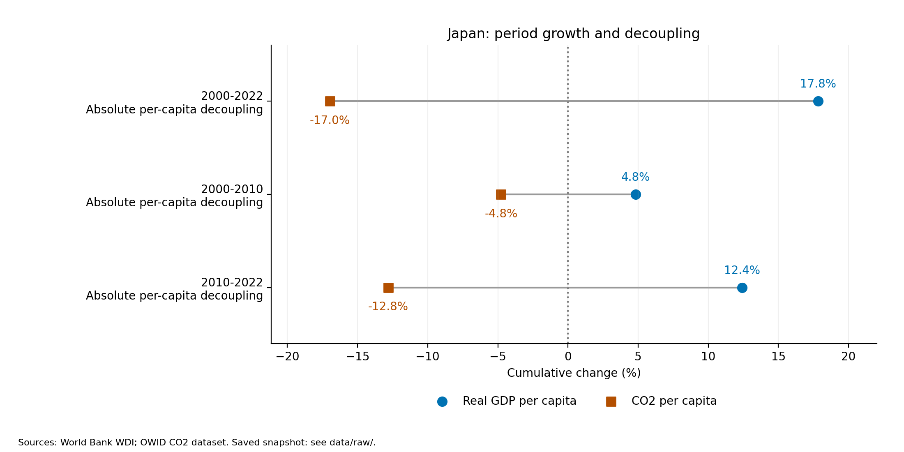
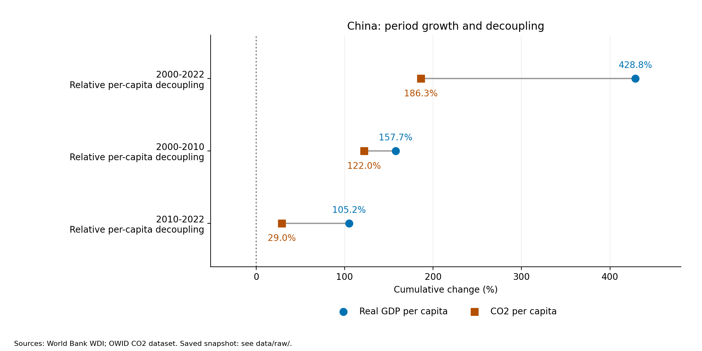

# Economic Growth and Per-Capita CO₂ Decoupling in East Asia

CISC7204 Class B, Team 01 semester project. This showcase uses the team's final analysis notebook.

**Research question**

Did real GDP per person and territorial CO₂ emissions per person move together in China, Japan, and South Korea between 2000 and 2022?

## Data and methods

The notebook joins [World Bank GDP per capita in constant 2015 US dollars](https://data.worldbank.org/indicator/NY.GDP.PCAP.KD) (CC BY 4.0) with territorial fossil and industrial CO₂ per person from the Global Carbon Project via the [pinned Our World in Data snapshot](https://github.com/owid/co2-data/tree/382ee6c662b0ece26e111f263b44c029afad7787). See the [OWID indicator and source terms](https://ourworldindata.org/grapher/co-emissions-per-capita) for attribution and third-party conditions. The repository includes the original World Bank response with attribution. The download script retrieves the pinned OWID CSV from its provider. The manifest records the retrieval URLs and checksums from the original analysis.

Using Python, pandas, and Matplotlib, we match 69 records by country and year, calculate cumulative percentage changes, and classify per-capita decoupling. The notebook also compares the result with a 2019 endpoint and with three-year endpoint averages. See the [codebook](CODEBOOK.md) for definitions and classification rules.

## Findings

| Country | Real GDP per person, 2000–2022 | CO₂ per person, 2000–2022 | Classification |
| --- | ---: | ---: | --- |
| China | +428.8% | +186.3% | Relative |
| Japan | +17.8% | −17.0% | Absolute |
| South Korea | +101.6% | +24.6% | Relative |

South Korea showed absolute per-capita decoupling during 2010–2022, with GDP per person up 34.5% and CO₂ per person down 3.8%. The full-period classifications remained the same under both alternative endpoint scenarios.





The charts use country-specific scales. Use the table to compare the magnitudes across countries.

## Limitations

The classification describes observed changes. Territorial fossil and industrial CO₂ excludes emissions embodied in imports and does not cover land-use change or other greenhouse gases. The design cannot identify the effects of individual policies.

## Reproduce the analysis

Use Python 3.14.3 from this directory.

```sh
python -m pip install -r requirements.txt
python fetch_data.py
python -m jupyterlab
```

Open [East_Asia_Decoupling.ipynb](East_Asia_Decoupling.ipynb) and select **Restart Kernel and Run All Cells**. The notebook checks all 69 country-year observations and regenerates the tables in `data/processed/` and the charts and summary tables in `output/`. The download script checks the two inputs against their original SHA-256 hashes. Keep the committed World Bank snapshot. The current API response may reflect later revisions or updated metadata.
